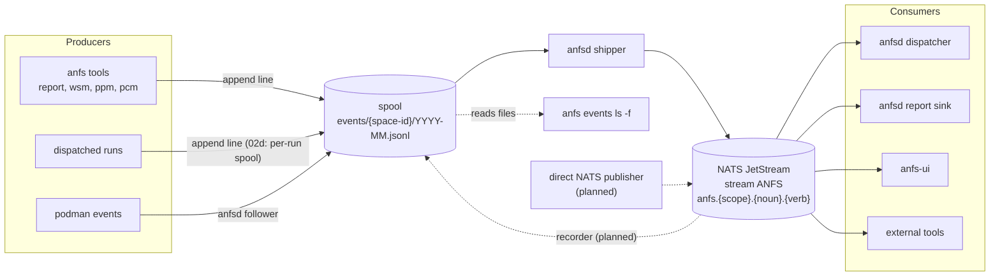
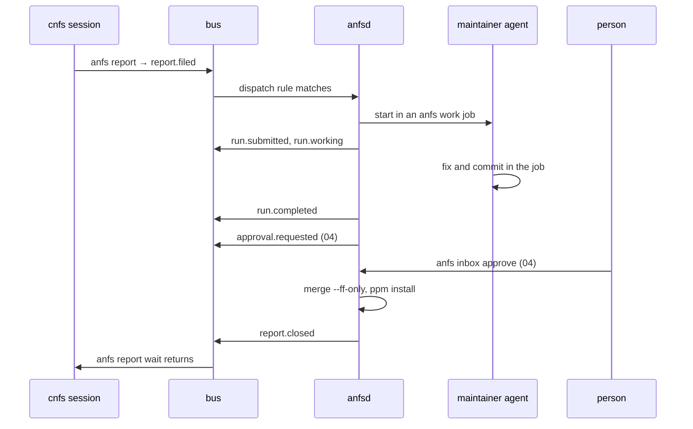
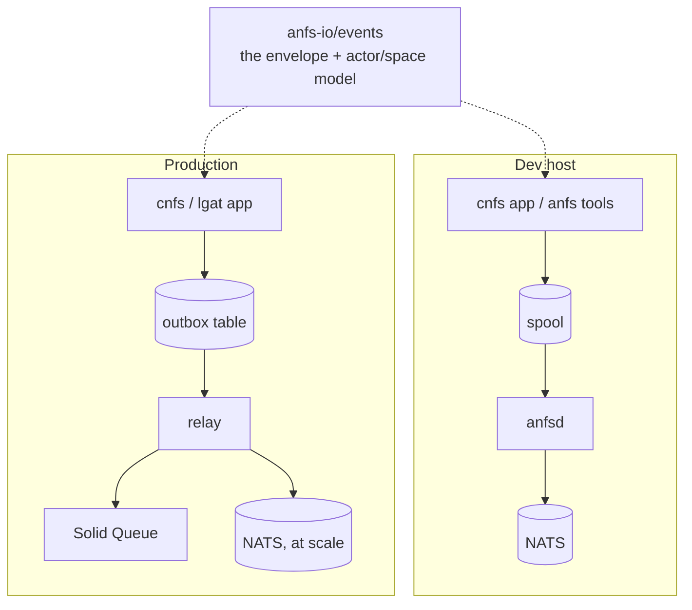
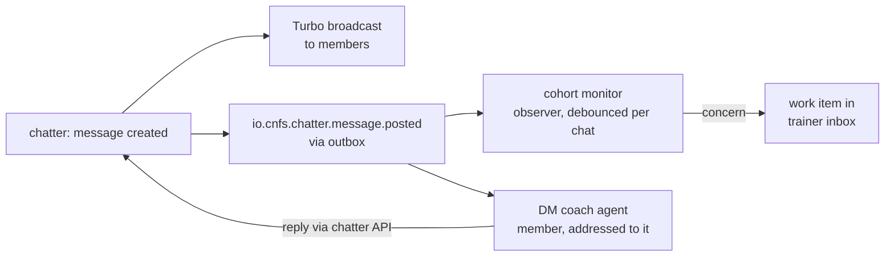
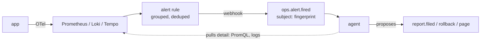

# Agent native: overview

A one-page map of the agents work, written 2026-10-24. It summarizes [AGENT-NATIVE.md](AGENT-NATIVE.md), [AGENT-NATIVE-REVIEW.md](AGENT-NATIVE-REVIEW.md) and the plans under [units/agents](units/agents.md). It decides nothing; where it and those differ, they win.

## 1. What we are building

**Spaces as agent homes, and a bus between them.** A space (a directory with a `space.yml` and a stable id) is where agents and the person work together. Agents get primitives the way Unix processes get files and pipes: events, identity, dispatch, an inbox, approvals.

**The bus** is four small things:

- **the envelope**: strict CloudEvents 1.0 plus our extensions (`actor`, `actorspace`, `actorrole`, `spacepath`, `anfsv`);
- **the spool**: JSONL files, one per space id and month; emitting is "append one line", from any language, and never blocks or fails;
- **the shipper**: `anfsd` tails the spool and publishes each line to NATS JetStream (stream `ANFS`, subjects `anfs.<scope>.<layer>.<noun>.<verb>`, decided 2026-10-24 in 05: today `anfs.<scope>.<noun>.<verb>` until 05b), exactly once per event id;
- **conventions**: subject naming, durable consumers named `<tool>-<purpose>`, an event catalog.

**anfs ships mechanisms; workflows are tenants.** Everything that *does* something with events (the dispatcher, the report sink, the podman follower, anfs-ui) is a tenant using only those public conventions, with no more privilege than a third-party tool would have. Acceptance test: turn off anfsd's dispatcher for one space, let another tool run that space end to end, change no core code.

**It is a dev-environment tool.** `anfsd` never goes to production. What higher layers (cnfs, lgat, RWS) inherit is the **contract**: the envelope and the actor/space model, published as a standalone spec. In production they implement it on their own infrastructure.

### Status

| Piece | What | Status |
|---|---|---|
| 01 events | space ids, `anfs_emit`, the JSONL log, `wsm/anfs events ls`, `report.filed/closed` | merged |
| 02a bus | `core/nats`, `anfsd` shipper, `anfs bus`, `report wait` on events | merged |
| 02b dispatch | `agents:`, `dispatch:`, `access:` in `space.yml`; runs in `anfs work` jobs; `run.*`; report sink | merged |
| 02c podman | `podman events` → `container.*`, `pod.*` | merged |
| 03 ui | anfs-ui reads the bus, polling becomes a slow reconcile | merged |
| 02d safe dispatch | per-run spool, actor stamping, env allow-list, settings isolation, overflow delays, per-space dispatcher off | planned |
| 04 inbox | approvals as events, `anfs inbox`, per-space `approvals:`, anfsd performs approved steps | planned |
| 05 spec | `anfs-io/events`: the profile as a versioned, language-neutral spec with conformance examples | planned |

## 2. How it works

### 2.1 The pieces



- The files are written first and are the complete, permanent, greppable record. The stream is a bounded window (90 days / 1 GiB) for programs.
- `wsm events ls` and `anfs events ls` read the files, whether NATS is up or not.
- Consumers are durable, ack explicitly, and are idempotent by event id (delivery is at-least-once).
- **Planned (05 revision):** producers with a NATS client publish directly; a recorder consumer mirrors those events back into the files, so "the files are the complete record" holds for both paths.

### 2.2 The report pipeline

The first real workflow, run by hand seven times on 2026-10-22/23, now mostly on the bus. Steps marked 04 are planned.



Today (02b) the run ends with commits in a job and the person lands it by hand. 04 makes landing a declared step: the rule says `land: [merge, install]`, anfsd asks, the person (or policy `auto`) answers in `anfs inbox`, and anfsd runs only the fixed commands shown in the request.

### 2.3 Anatomy of one event

One line of the spool, as shipped:

```json
{
  "specversion": "1.0",
  "id": "01a163ec-46aa-7c41-9d3e-5f0a2b8c4d17",
  "source": "/anfs/spaces/tkj76y3nfx",
  "type": "io.anfs.report.filed",
  "subject": "r-20261022-2",
  "time": "2026-10-22T14:03:11.402Z",
  "datacontenttype": "application/json",
  "data": {"to": "file", "package": "core/pcm", "title": "pcm validate misses x-pcm.depends_on"},
  "actor": "claude:2e9431a0",
  "actorspace": "k3x7q2mbzp",
  "actorrole": "partitia",
  "spacepath": "anfs-dev",
  "anfsv": 1
}
```

- `id`: UUIDv7, globally unique, the dedup key; its timestamp matches `time`.
- `source`: the space where it happened, by id (renames do not break history); `spacepath` is the path at the time, informational.
- `type`: `io.<layer>.<noun>.<verb>`, past tense. The short type (`report.filed`) is what `--type` filters and rules use. The NATS subject is `anfs.<scope>.` plus the type without `io.`, one shape for every layer: this one lands on `anfs.tkj76y3nfx.anfs.report.filed` (05, decided 2026-10-24; `anfs.tkj76y3nfx.report.filed` until 05b).
- `actor` / `actorspace` / `actorrole`: who acted, and as what, in which space. Here cnfs's agent files into anfs-dev.
- Thin: at most 4096 bytes. An event says what changed; detail is read from the item.
- Planned: `data` as any JSON object (05 revision), `traceparent` for tracing, the actor stamped by anfsd for runs (02d) and attested by the publisher in production.

### 2.4 Dev vs production



Same envelope on both sides; only the transport is configuration. No anfsd, runs, dispatch rules or harnesses in production: orchestration there is ActiveJob/Solid Queue plus an approvals engine, with a durable workflow engine only if long agent conversations need one.

## 3. Who interacts

Integration levels: **wrapped** (unaware of the bus; its package adds hooks that emit for it), **emitter** (appends to the spool or publishes to NATS), **participant** (runs a durable consumer). A ppm package bundles the tool, its bus adapter and its skill.

| Who | Role | Level | Status |
|---|---|---|---|
| anfs tools (`anfs report`, wsm, ppm, pcm, ...) | producer | emitter | today |
| podman | producer | wrapped (anfsd's follower) | today |
| anfsd dispatcher, report sink | both | participant (tenants) | today |
| anfs-ui | consumer | participant | today |
| the person (`anfs inbox`, ui) | both | via the inbox path | planned (04) |
| cnfs Rails engines (bus gem) | both | emitter + participant | planned (cnfs roadmap) |
| lgat (Solana indexer) | producer | emitter | planned (lgat roadmap) |
| beads | both | participant | candidate |
| Firstmate | consumer | participant (dispatcher) | candidate |
| herdr | producer | wrapped | candidate |
| Pi Durable | consumer | participant (runner) | candidate |
| Telemetry (OTel → Grafana) | producer of alerts only | bridge | candidate |
| Jev vault scanner | producer | emitter | candidate |

### anfs tools

Bash tools emit through `lib/anfs/events.sh` (`anfs_emit`): one appended line, no client.

- `anfs report new` in cnfs files into anfs-dev: `report.filed` in anfs-dev's scope, actor cnfs's agent. `anfs report close` emits `report.closed`.
- `anfs src update` emits `source.updated`; anfs-ui refreshes its sources list once, and dispatch reloads its rules.

### podman (wrapped)

anfsd runs `podman events` and writes `container.*` / `pod.*` into the host scope, coalesced and rate-limited.

- A pcm postgres dies: `container.died` (with `pcm` and `exit`); the ui flips that row to stopped without re-listing anything.
- The podman machine stops: `podman.disconnected`; on return, `podman.connected` triggers one reconcile.

### anfsd dispatcher and report sink (tenants)

The dispatcher reads `dispatch:` rules from each `space.yml` and starts a role's harness (claude, opencode, pi, antigravity) in an `anfs work` job, emitting `run.*` (A2A task states). The sink renders reports into BACKLOG.md, which is now a view.

- `report.filed` with `package: core/*` in anfs-dev starts the maintainer (concurrency 1, budget $10) in job `fix-<report id>`.
- `anfs agents ls` shows the run; `anfs agents stop` cancels it (`run.canceled`).

Planned (02d): runs emit into a per-run spool `runs/<id>/events/` that anfsd ingests, stamping the real actor (a run's claim is kept as `actorclaimed`); an env allow-list so credentials never reach runs; isolated harness settings; overflow delays instead of dropped events; a per-space "dispatcher off" switch.

### anfs-ui (consumer)

Durable consumer `ui` as the read-only `reader` user; each event updates only the kind it names; polling is a 5-minute reconcile.

- The `/events` page: the latest 100 events with type, subject, space and actor.
- Planned (04b): the inbox panel, answering merge/install and redispatch/dismiss through its write grant.

### The person

Approvals are per-space policy (`approvals:` in `space.yml`: `person` or `auto` for merge, install, push). A policy change only takes effect when the person accepts it at a terminal; no agent changes its own.

- `anfs inbox` lists a pending merge with commits, diffstat, the `verify:` result and the run's summary; `anfs inbox approve` lands it, and the report closes.
- A `report.filed` turned away by a full queue shows in the inbox until redispatched or dismissed.

### CNFS Rails engines

`Rails.event` (ActiveSupport::EventReporter, Rails 8.1) is the front door; the planned cnfs bus gem does the rest:

1. **emit**: engines call `Rails.event.notify(...)`; context carries tenant (space id), actor, role;
2. **map**: an allow-list (never firehoses like `sql.active_record`) → `io.cnfs.<engine>.<noun>.<verb>`;
3. **persist**: a transactional outbox row, same transaction as the change;
4. **ship / consume**: dev → spool or NATS; prod → outbox relay. Inbound events become ActiveJob jobs, idempotent by event id.

Use cases:

- **partitia auth**: sign-in, grant and role changes as actor events, proving the actor model in Rails: staff and agents differ only in grants.
- **chatter**: the bus is how agents *react* to chat, not how chat works. Delivery to people stays Turbo Streams.



The cohort monitor mostly concludes "nothing to do" and only proposes; the DM coach is a chat member posting like a human. Cautions: debounce, per-chat ordering, a fast lane to a human for safety, fail open toward people, disclosure.

### LGAT

Built on cnfs engines, so it uses the gem. Its Solana programs get an indexer (a pcm service in dev, with `solana-test-validator`) that decodes Anchor events and emits `io.lgat.<program>.<event>`, subject the transaction signature, with a `commitment` extension.

- `payment.requested` → a signer submits the transaction → the program emits → the indexer publishes `io.lgat.escrow.payment.settled` (only on `finalized`) → Rails consumes it.
- Re-indexing the chain yields the same events: ids are derived from the transaction, so consumers dedupe.

### beads, Firstmate, herdr (candidates, if adopted)

- **beads** (work-item tracker): the bus carries facts (`filed`, `assigned`, `closed`), beads owns the record in its git-backed store. A space with `tracker: beads` files a work item; other spaces see `filed` and `closed` without knowing beads.
- **Firstmate** (alternative dispatcher): a space turns anfsd's dispatcher off and Firstmate consumes its events end to end. This is the flexibility acceptance test.
- **herdr** (agent panes and state): wrapped; its package's hooks emit pane and agent state changes so the ui and other agents can see who is working where.

### Pi Durable (candidate)

A long-lived runner holding checkpointed conversations: a peer consumer, not something anfsd spawns per event.

- A space with `runner: pi-durable` consumes `report.filed`; the event id becomes Pi's request id (free dedupe); the bus message is acked only after Pi commits.
- A crash mid-conversation resumes in a new process instead of restarting the agent from zero.

### Telemetry (OTel → Grafana)

Not on the bus. One front door (`Rails.event`), two pipelines: telemetry is lossy and for operators; bus events must not be lost and are for actors. Spans and metrics never go on the bus, and business logic never reads traces. `traceparent` in each event joins the two.



- An error-rate alert fires once; one event; an agent queries Loki, files a report.
- A scheduled review event starts an agent that looks for slow trends and files findings.
- Alerts about the bus or the agents themselves go out of band to a human, never over the bus.

### Jev vault scanner (candidate)

An emitter for Obsidian: note and vault change events, principle 6 (real event sources, not polling) applied to the person's notes.

- A note tagged as a task changes: an event lets a space's agent pick it up as a work item.
- A daily note is written: an agent subscribed to it updates a summary.

## Glossary

| Term | Meaning |
|---|---|
| space | a directory with a `space.yml`: where agents and the person work; holds repos, skills, rules, policy |
| space id | stable 10-char id (`id:` in `space.yml`), never changes, survives `wsm move`; events are stored and addressed by it |
| actor | who acted: `<kind>[:<name>]`, e.g. `claude:2e9431a0`, `shell:rob`, `anfsd`, `podman` |
| role | what the actor acted as (`maintainer`); separate from the actor, recorded in `actorrole` |
| scope | the second subject token (`anfs.<scope>.…`): a space id, or `host` for host-level events |
| spool | the JSONL files under `~/.local/state/anfs/events/<scope>/`; the way in and the permanent record |
| tenant | anything that acts on the bus using only public conventions, anfsd's own dispatcher included |
| run | one dispatched agent execution, with a record under anfsd's state and `run.*` events |
| job | an isolated `anfs work` workspace (worktrees on a branch) where a run does its work |
