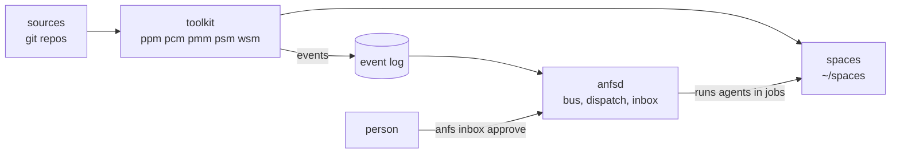

# ANFS

ANFS (Agent Native Full Stack) makes a machine reproducible from git repositories you control, and gives the agents that work on it the same footing as the people who do: an identity, an event log, an inbox, and work dispatched to them in isolated jobs.

## What it is

ANFS is built in layers, each a small set of tools with one idea of where things come from.

- **The core toolkit.** Small bash tools that read **sources**, git repos listed in priority order: `ppm` for packages (software and dotfiles), `pcm` for podman compose services, `pmm` for virtual machines, `psm` for agent skills, `wsm` for spaces, and `anfs` for the sources and the commands that span them. Your repo sits on top, so you override one file from a shared repo without forking it. A machine is disposable: everything that makes it yours is committed, and `anfs implode` takes it back to vanilla.
- **The stack.** The shared source of packages, containers and skills (shells, editors, languages, agent harnesses, Postgres and friends), grouped by category. An organization ships its own the same way: one repo with `packages/`, `containers/`, `skills/`, `spaces/` and `stacks/`.
- **The bus.** Every tool appends what happened to an event log per space (CloudEvents, one JSON line each). `anfsd`, the daemon, ships the log to NATS JetStream for programs to consume, runs each space's dispatch rules (an event starts an agent in a job of its own, supervised), and lands what an agent committed once a person approves it in `anfs inbox`. The event format is a standalone spec, [anfs-io/events](https://github.com/anfs-io/events), so the layers built on ANFS speak it in production without anfsd.
- **Spaces.** A space is a directory with a `space.yml` and a stable id, linked into `~/spaces/`. It holds an organization's or project's repositories, skills and rules, and it is where agents and people work together: its events, its roles (a Claude Code session can hold its `coordinator` role), its approval policy.



Each layer serves the ones above it: ANFS is the foundation, and the organizations and products built on it (Roteoh, RWS, LGAT, cnfs) consume it as spaces and sources of their own.

This repository holds the planning and design docs for [anfs](https://github.com/anfs-io/system) and [stack](https://github.com/anfs-io/stack). The code repos keep only what has to travel with a clone: READMEs and agent instructions (`AGENTS.md`).

## Contents

### Start here

- [COMMANDS.md](COMMANDS.md): every command, by what you want to do: set up a machine, install packages, work in a space, run agents, report a bug, approve in the inbox, watch events, coordinate with Claude Code, troubleshoot; then a reference per tool.
- [AGENT-NATIVE-OVERVIEW.md](AGENT-NATIVE-OVERVIEW.md): a one-page map of the agent-native work: the bus, how an event flows, who takes part.

### Direction and plans

- [AGENT-NATIVE.md](AGENT-NATIVE.md): what the A in ANFS means: the primitives agents get (work items, events, identity and inbox, dispatch, grants, supervision), principles and decisions.
- [AGENT-NATIVE-REVIEW.md](AGENT-NATIVE-REVIEW.md): a review of that plan and its first implementation, with recommendations.
- [ROADMAP.md](ROADMAP.md): the master checklist for the toolkit: images, one API, deployment, in order.
- [ROADMAP-apps.md](ROADMAP-apps.md): the second roadmap: apps, infrastructure, components.
- [BACKLOG.md](BACKLOG.md): ideas not yet units, and the bug reports filed against the toolkit.

### Directories

- [units/](units/): one file per unit of work (`units/<unit>.md`: objective, status, decisions), with its plans and logs in `units/<unit>/`. Good entry points: [agents](units/agents.md) (the bus, dispatch, inbox, coordinator), [stacks](units/stacks.md), [wsm-spaces](units/wsm-spaces.md), [report](units/report.md), [tutorial](units/tutorial.md).
- [notes/](notes/): evaluations and one-off investigations: [orchestrators](notes/orchestrators-eval.md), [ONCE and ingress](notes/once-eval.md), [shell snippet order](notes/shell-sort.md), [package debug mode](notes/dev-debug.md), [old names](notes/old-names.md).
- [adr/](adr/): architecture decision records, named `<package>-NNN-<title>.md`: [op-001 remote credential forwarding](adr/op-001-remote-credential-forwarding.md).
- [reviews/](reviews/): reviews of the environment the toolkit runs in: [Claude Code settings](reviews/claude-settings.md).

## Repository layout

```
units/<unit>.md     a unit: objective, status, decisions, completion criteria
units/<unit>/       its plans (NN-name/plan.md) and logs (log.md)
notes/              evaluations and one-off investigations
adr/                architecture decision records, named <package>-NNN-<title>.md
reviews/            reviews of tools and settings around the toolkit
```

Docs written before the repos merged use old names: see [notes/old-names.md](notes/old-names.md).
